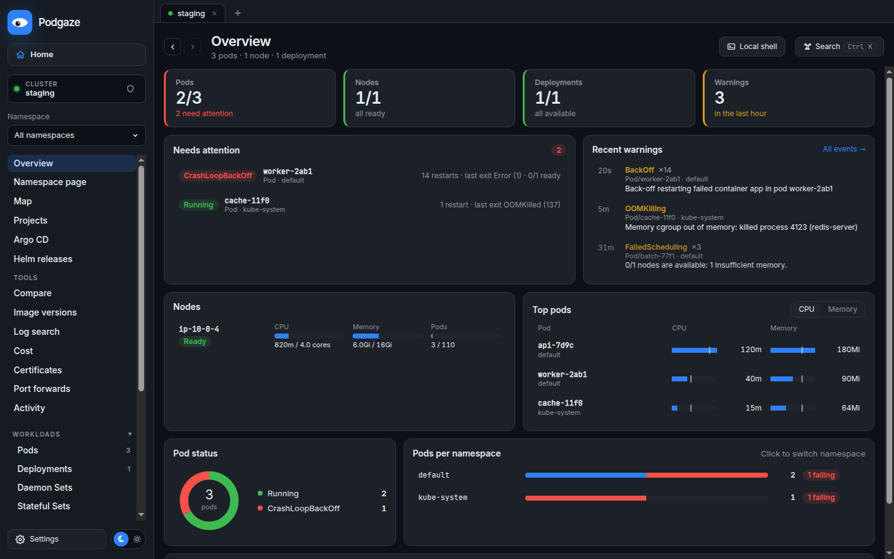
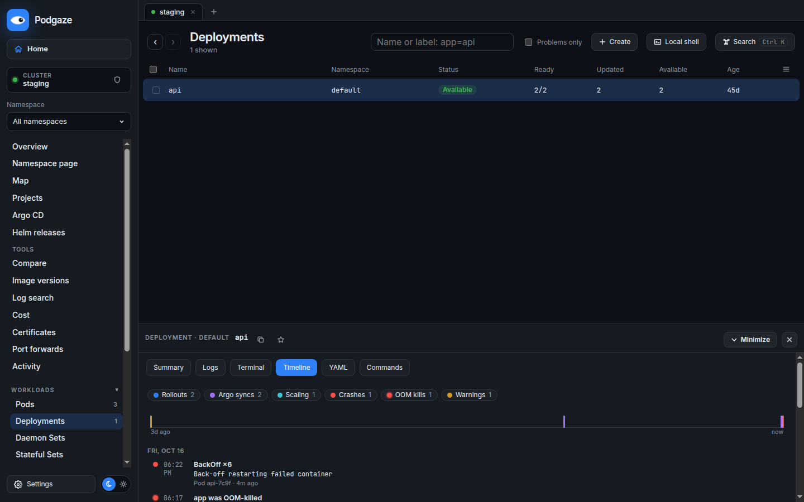

# Podgaze

A desktop Kubernetes IDE for the clusters already in your kubeconfig. Browse and edit resources, read logs, open
shells, roll out and roll back, and see what costs what and what is about to expire, without leaving one window.



## Install

Download the file for your system from the [latest release](https://github.com/vahe17s/podgaze/releases/latest).

### Linux

**Debian, Ubuntu, and derivatives (.deb)**

```sh
sudo apt install ./Podgaze-<version>-linux-amd64.deb
```

Podgaze then appears in your applications menu, and `podgaze` starts it from a terminal. To remove it:
`sudo apt remove podgaze`.

**Any distribution (AppImage)**

```sh
chmod +x Podgaze-<version>-linux-x86_64.AppImage
./Podgaze-<version>-linux-x86_64.AppImage
```

AppImages need FUSE 2. On Ubuntu 22.04 and newer install it once with `sudo apt install libfuse2` (Ubuntu 24.04:
`libfuse2t64`). If your system blocks Chromium's sandbox for AppImages (common on Ubuntu 24.04), either use the
.deb, which sets this up, or start the AppImage with `--no-sandbox`.

### macOS

1. Open `Podgaze-<version>-mac-arm64.dmg` (Apple silicon) or `Podgaze-<version>-mac-x64.dmg` (Intel).
2. Drag **Podgaze** into **Applications**.
3. The app is not notarized by Apple yet, so the first launch needs one extra step: right-click Podgaze in
   Applications, choose **Open**, then **Open** again. Or run once:
   ```sh
   xattr -dr com.apple.quarantine /Applications/Podgaze.app
   ```

### Windows

1. Run `Podgaze-<version>-win-x64.exe` and follow the installer (it can install for your user only, and you can
   choose the folder).
2. The installer is not code-signed yet. If SmartScreen says "Windows protected your PC", choose
   **More info → Run anyway**.

### Updates

Podgaze checks GitHub for new releases a few times a day (turn this off in **Settings → About**).

- **Windows and AppImage:** the update downloads in the background; Podgaze asks before restarting to install it.
- **.deb and macOS:** Podgaze tells you a new version is out and links to it. Install it the same way as the first
  time (`sudo apt install ./Podgaze-<version>-linux-amd64.deb`, or the new .dmg).

## Before you start

Podgaze reads the same kubeconfig as `kubectl`: `~/.kube/config`, or the files in `KUBECONFIG`. You can point it
at another file from the start screen. `kubectl` itself is not needed. Some features use tools you may already have:

| Feature | Needs |
| --- | --- |
| Clusters whose kubeconfig logs in through a plugin (AKS with Entra ID, EKS, GKE) | That plugin on your `PATH`: `kubelogin`, `aws`, or `gke-gcloud-auth-plugin` |
| Install, upgrade, and roll back Helm releases | `helm` on your `PATH` (listing releases works without it) |
| Add cloud cluster (AKS, EKS, GKE) | `az`, `aws`, or `gcloud`, signed in |
| CPU and memory usage, right-sizing, "actually used" cost | metrics-server in the cluster |
| Argo CD view | Argo CD installed in the cluster |
| Certificates from cert-manager, External Secrets syncs | Those operators installed (TLS Secrets and webhook CAs work without them) |

When you start Podgaze from a menu or the dock, it reads `PATH` and `KUBECONFIG` from your login shell, so tools
installed with Homebrew, `~/.local/bin`, and similar are found.

## What it does

**Everyday work**
- Live lists of pods, workloads, nodes, config, networking, storage, RBAC, and custom resources, with filters
  (`app=api`, `env in (dev,test)`), column choice, multi-select, and pins.
- Details for any object: summary, related objects, events, logs (follow, previous, time range, all pods of a
  workload), shell into containers, node shell, YAML editing with a server-side dry run and a diff before applying.
- Right-click menus with the common actions for each kind: restart, scale, set image, pause and resume rollouts,
  roll back, cordon and drain, run a CronJob now, port forward, and more.
- Several clusters open at once as tabs, a command palette (Ctrl K), and back and forward navigation.

**Understanding a cluster**
- **Overview** of health, warnings, node usage, and top pods; a **map** of how objects connect (Ingress and Istio
  routing to Services, workloads, pods, and the config they read).
- **Namespace page**: health, cost, and expiring items for one namespace or a whole team's project.
- **Timeline** per workload: rollouts with the image that changed, Argo CD syncs, scaling, crashes, OOM kills, and
  warnings on one axis.
- **Log search** across every pod of a workload or a namespace at once, with saved searches.
- **Compare** the same app across namespaces and clusters, and **image versions** across clusters.

**Cost and expiry**
- **Cost**: node prices (looked up from Azure's public price list, or entered for any cloud), your discount,
  storage by class, split by what each workload requests, next to what it actually uses.
- **Certificates and expiry**: TLS certificates, cert-manager Certificates, webhook and APIService CAs, External
  Secrets syncs, and the client certificates in your kubeconfig, soonest first.

**Helm and Argo CD**
- Helm releases with values, manifest, history, and rollback; install from repositories or Artifact Hub; upgrades
  always show what will change before they run.
- Argo CD applications with sync, refresh, history, and rollback.

## Safety

- Mark a cluster **Protected** (destructive actions ask you to type the name) or **Read-only** (Podgaze refuses
  every change), per cluster and per namespace. Contexts named like prod, prd, production, or live start Protected.
- Edits are dry-run on the server first and shown as a diff. Helm upgrades show every object they change.
- Every change Podgaze makes is listed under **Activity**, with the `kubectl` command that does the same thing, and
  can be exported as a script.
- Before Podgaze edits your kubeconfig (rename, remove, add a cloud cluster), it saves a private backup next to it.

## Privacy

Podgaze talks to your clusters with your kubeconfig credentials. Beyond that it only goes online when you ask it
to:

- **Look up Azure prices** sends VM sizes and regions to Azure's public Retail Prices API.
- **Search Artifact Hub** in the Helm install dialog sends your search text to artifacthub.io.
- **Update checks** ask GitHub whether a newer Podgaze release exists (Settings → About turns them off).
- Helm itself reaches the chart repositories you add, and the cloud CLIs reach their clouds.

Settings, saved searches, and prices are stored on your computer only. There is no telemetry.

## Build from source

Requires Node.js 20+ and pnpm 9.

```sh
pnpm install
pnpm dev          # run the app with hot reload
pnpm test         # all tests
pnpm dist:linux   # build the AppImage and .deb into apps/desktop/release
pnpm dist         # build installers for the system you are on
```

To work on the interface without a cluster, run `pnpm --filter @podgaze/ui dev` and open
http://127.0.0.1:5173/?preview in a browser: it runs on built-in demo data.

### Project layout

| Path | What is in it |
| --- | --- |
| `apps/desktop` | Electron main process, the bridge to the window, packaging (`electron-builder.yml`) |
| `packages/ui` | The interface (React) |
| `packages/cluster` | Talking to Kubernetes, Helm, Prometheus, and the cloud CLIs |
| `packages/contracts` | Types shared by the three |

### Releasing

1. Set the new version in `apps/desktop/package.json`.
2. Commit, then tag and push: `git tag v<version> && git push origin v<version>`.
3. GitHub Actions builds the Linux, macOS, and Windows installers, starts each one once to check it works, and
   attaches them to a draft release. Review it and publish.


